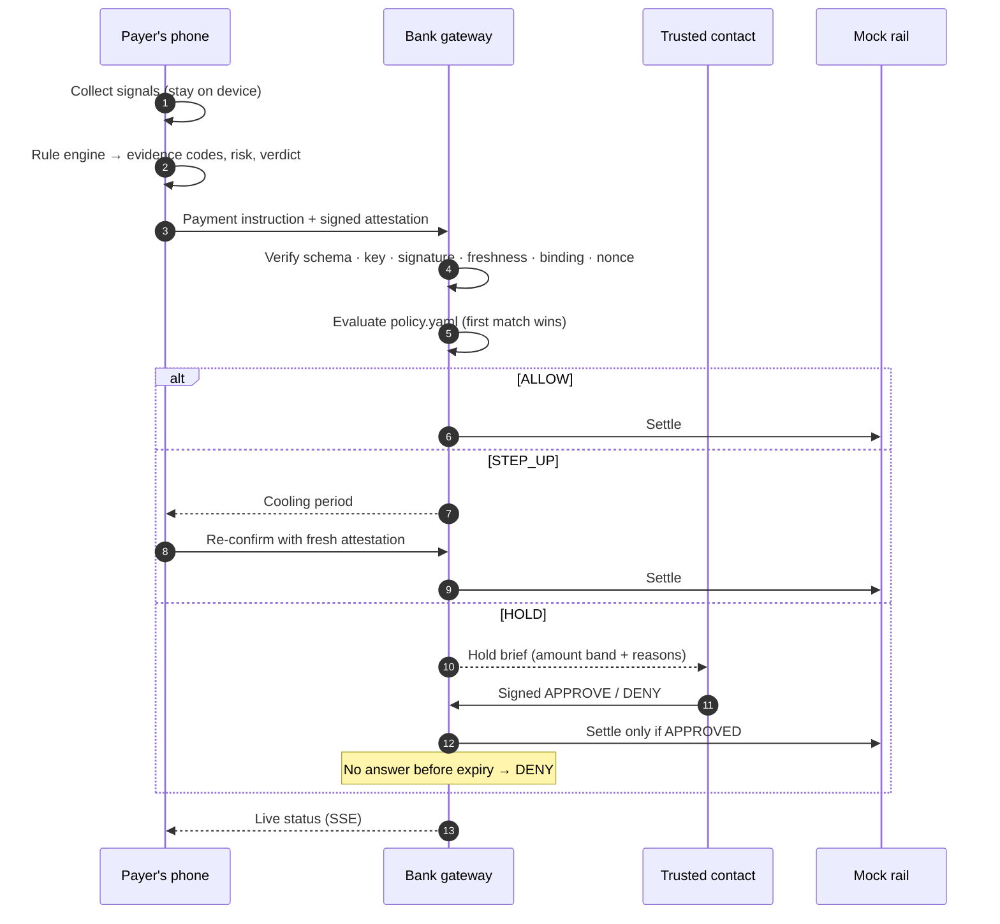
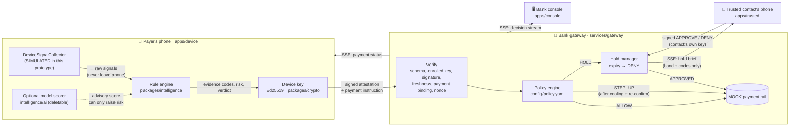

<div align="center">

# ❚❚ VIRAAM

### A coercion-aware circuit breaker for UPI payments

*Viraam* (विराम) means **pause**. It is the one thing a scam victim needs and today's payment rail can't give them.

[](#)
[](#)

[](https://www.typescriptlang.org/)
[](https://react.dev/)
[](https://nodejs.org/)
[](https://expressjs.com/)
[](https://vitejs.dev/)
[](https://pnpm.io/)
[](https://zod.dev/)

[](#-the-attestation)
[](#-verification)
[](#-quick-start)
[](#-real-vs-simulated)
[](#-ai-supports-the-system-it-is-not-the-system)

**[Quick start](#-quick-start)** · **[How it works](#-how-it-works)** · **[Architecture](#-architecture)** · **[Privacy](#-what-never-leaves-the-phone)** · **[Demo script](#-90-second-demo-script)** · **[Project document (PDF)](docs/VIRAAM-Project-Document.pdf)**


</div>

---

## 📌 Table of contents

- [The problem](#-the-problem)
- [What VIRAAM does](#-what-viraam-does)
- [Screenshots](#-screenshots)
- [Quick start](#-quick-start)
- [How it works](#-how-it-works)
- [Architecture](#-architecture)
- [The attestation](#-the-attestation)
- [What never leaves the phone](#-what-never-leaves-the-phone)
- [Bank-side policy engine](#-bank-side-policy-engine)
- [AI supports the system; it is not the system](#-ai-supports-the-system-it-is-not-the-system)
- [REAL vs SIMULATED](#-real-vs-simulated)
- [`DeviceSignalCollector`: the native seam](#-devicesignalcollector-the-native-seam)
- [Demo scenarios](#-demo-scenarios)
- [90-second demo script](#-90-second-demo-script)
- [Verification](#-verification)
- [API reference](#-api-reference)
- [Project structure](#-project-structure)
- [Known limits and roadmap](#-known-limits-and-roadmap)

---

## 🚨 The problem

In a **"digital arrest"** scam, a fraudster posing as police, customs or a regulator keeps the victim on a
video or voice call for hours. They convince the victim to install a "verification" app that is really a
remote-access tool, and then direct them to move their savings to a "safe custody" account.

To the payment rail, every one of these transfers looks **legitimate**: the right user, the right device, the
right UPI PIN, a valid payee. Fraud systems score the *counterparty* and the *transaction*, but the
signal that matters is **the situation the payer is in**, and that only exists on the phone.

> The victim isn't hacked. They're **coerced**. Authentication can't stop a user who is authenticating
> under duress.

## 🛡 What VIRAAM does

VIRAAM is a **consent layer between the phone and the payment rail**.

1. At payment time, the device evaluates its **situational context** (long active call, remote control or screen share, first-seen payee, unusual hour, unusual amount) with a **deterministic rule engine**.
2. It emits an **Ed25519-signed attestation** containing a verdict, a 0–100 session risk and **evidence codes only**. It contains no phone numbers, app names, screen contents or history.
3. The bank **verifies** the signature, freshness, payment binding and nonce, then applies a **declarative policy file**:

| Outcome | What happens |
|---|---|
| ✅ **ALLOW** | Payment goes straight to the rail. Normal payments don't notice VIRAAM. |
| ⏸ **STEP_UP** | A cooling-off period, then the payer must re-confirm with a *fresh* attestation. |
| 🧊 **HOLD** | Payment frozen. The payer's **trusted contact** approves or denies on *their own* device with *their own* key. No answer before expiry means **DENY**: silence never releases money. |

### Key features

- 🔏 **Signed situational attestations**: Ed25519, domain-separated, canonical JSON, bound to exactly one payment, single-use nonce.
- 🧾 **Evidence codes, not data**: eight boolean facts. The schema is `.strict()`, so raw data can't be smuggled in.
- 📜 **Policy as data**: the bank's rules live in a readable, schema-validated [`policy.yaml`](services/gateway/config/policy.yaml).
- 👥 **Trusted-contact escalation**: signed approve/deny, live over SSE, with safe expiry to DENY.
- 🎯 **False-positive guard**: a long call *alone* is detected but never blocked.
- 🧠 **Removable AI**: the rule engine is the default path. Delete the `ai/` folder and everything still builds, runs and passes.
- 📺 **Projector-ready console**: a live decision stream showing which evidence codes and which rule drove each verdict.
- 🔌 **Fully offline**: no external APIs, CDNs or fonts, and a mock payment rail.

---

## 📸 Screenshots

<table>
  <tr>
    <td width="50%"><b>Without VIRAAM</b>: the ₹2,00,000 just goes.<br/></td>
    <td width="50%"><b>With VIRAAM</b>: the same situation is paused.<br/></td>
  </tr>
  <tr>
    <td><b>Trusted contact</b> sees a band and reasons, not the payee.<br/></td>
    <td><b>Outcome</b>: Ravi said no, so the money stays.<br/></td>
  </tr>
  <tr>
    <td colspan="2"><b>Bank console</b>: live decisions with the evidence and rule behind each one.<br/></td>
  </tr>
</table>

---

## 🚀 Quick start

**Prerequisites:** Node.js **20+** and **pnpm 9** (`corepack enable`, or `npm i -g pnpm@9`).

```bash
git clone https://github.com/yaswanthme007/viraam.git
cd viraam
pnpm install
pnpm dev
```

`pnpm dev` starts all four processes:

| URL | View |
|---|---|
| http://localhost:5173 | 📱 **Payer's phone**: scenario picker, phone, "stayed on phone" vs "sent to bank" panels |
| http://localhost:5174 | 🤝 **Trusted contact's phone** (Ravi) |
| http://localhost:5175 | 🏦 **Bank console**: live decision stream |
| http://localhost:4000 | ⚙️ **Gateway**: attestation verify, policy, mock rail, SSE |

| Command | What it does |
|---|---|
| `pnpm dev` | Run everything |
| `pnpm verify` | End-to-end verifier: every scenario plus attack cases against the real gateway (52 checks) |
| `pnpm typecheck` | `tsc` across all 7 workspace packages |
| `pnpm build` | Production build of the three React apps |

> No network access is needed at runtime: no external APIs, CDNs or web fonts.

---

## ⚙️ How it works



---

## 🏗 Architecture



### Tech stack

| Layer | Technology |
|---|---|
| Frontends | React 18, Vite 5, plain CSS (system fonts, no CDN) |
| Gateway | Node 20, Express 4, Server-Sent Events, `yaml` |
| Schemas and types | Zod 3 (strict), TypeScript 5 |
| Cryptography | `@noble/curves` Ed25519, `@noble/hashes` SHA-256 |
| Monorepo | pnpm workspaces; packages consumed as TypeScript source |
| Verification | `tsx` end-to-end script against the real HTTP + SSE gateway |

---

## 🔏 The attestation

What actually crosses the wire in the "digital arrest" scenario:

```json
{
  "alg": "Ed25519",
  "keyId": "key_dev_asha_demo_01",
  "payload": {
    "version": 1,
    "deviceId": "dev_7f3a9c2e1b5d",
    "issuedAt": 1761552840000,
    "nonce": "9b1e4c7a2f6d3e8b0a5c1d7e4f2a9b6c",
    "sessionRisk": 100,
    "verdict": "HOLD",
    "evidence": ["CALL_ACTIVE_GT_30M", "REMOTE_ACCESS_SERVICE_ACTIVE", "PAYEE_FIRST_SEEN", "AMOUNT_GT_P99", "OFF_PATTERN_HOUR"],
    "payeeNovelty": "FIRST_SEEN",
    "amountBand": "1L_TO_5L",
    "paymentBinding": "7b9afee625c1f918f4020550790d75a273599f8363487d5b786507f6116084ec",
    "scorer": "rules-v1"
  },
  "signature": "a6af7a8d…2944c00"
}
```

| Field | Meaning |
|---|---|
| `deviceId` | Pseudonymous per-install id. Not an IMEI, phone number or account id. |
| `issuedAt`, `nonce` | Freshness and replay protection. |
| `sessionRisk`, `verdict` | The device's own assessment: advisory input to bank policy. |
| `evidence` | Boolean situational facts (below). |
| `payeeNovelty`, `amountBand` | Coarse buckets, never exact history or amounts. |
| `paymentBinding` | `sha256(canonical{paymentId, payeeVpa, amountPaise})`, valid for exactly one payment. |
| `scorer` | Provenance: `rules-v1`, or `rules-v1+model-lr-v0` when the optional model is on. |

The signature covers `"VIRAAM-ATTESTATION-v1\n" + canonicalJSON(payload)` with sorted keys. The domain prefix stops
a signature for one message type from being replayed as another.

### Evidence codes

| Code | Asserts |
|---|---|
| `CALL_ACTIVE_GT_30M` | A voice call has been active for over 30 minutes |
| `REMOTE_ACCESS_SERVICE_ACTIVE` | A service that can read or drive the screen is running |
| `SCREEN_SHARE_ACTIVE` | The screen is being captured or mirrored |
| `SIDELOADED_APP_RECENT` | An app from an unknown source was installed in the last 72 h |
| `PAYEE_FIRST_SEEN` | This device has never paid this payee |
| `AMOUNT_GT_P99` | Amount exceeds the user's own 99th-percentile payment |
| `OFF_PATTERN_HOUR` | Outside the user's usual transacting hours |
| `RAPID_APP_SWITCHING` | Unusually frequent app switching (a coaching signal) |

---

## 🔒 What never leaves the phone

| Never transmitted | Why it's excluded | Sent instead |
|---|---|---|
| Caller's number, contact name | Identifies a third party who never consented; would turn the bank into a call-log collector | `CALL_ACTIVE_GT_30M` |
| Call audio or transcript | Content surveillance, and unnecessary: *duration while paying* is the signal | nothing |
| Exact call duration | Adds no decision value over the threshold and fingerprints behaviour | the code alone |
| App names or package names | Reveal health, religion, dating and finance apps; also brittle, since scammers rename tools | `REMOTE_ACCESS_SERVICE_ACTIVE`, `SIDELOADED_APP_RECENT` |
| Screen contents or screenshots | The most sensitive data on the device, and may include OTPs | `SCREEN_SHARE_ACTIVE` |
| Contact list, payee history | Social graph. The bank only needs "new or not" | `payeeNovelty` |
| Transaction history, percentile value | Spending profile | `AMOUNT_GT_P99`, `amountBand` |
| Location, usual hours, activity timeline | Movement and routine are highly identifying | `OFF_PATTERN_HOUR` |
| Hardware ids (IMEI, Android ID, MAC) | Cross-context tracking | pseudonymous `deviceId` bound to an enrolled key |

Minimisation continues downstream. The **trusted contact** sees an amount *band* and plain-language reasons,
but **not** the payee's name or VPA or the exact amount; `pnpm verify` asserts this. Raw signals exist only in
device memory long enough to be evaluated. The demo shows them in a panel labelled *"Stayed on this phone"*
for contrast.

---

## 📜 Bank-side policy engine

The verification pipeline is in [`services/gateway/src/verify.ts`](services/gateway/src/verify.ts). The first
failure rejects the payment, and it appears as `REJECTED` on the console:

| # | Check | Reject code |
|---|---|---|
| 1 | Strict schema parse | `MALFORMED` |
| 2 | `keyId` enrolled in `registry.json`, role `device`, bound to `deviceId` | `UNKNOWN_KEY` |
| 3 | Ed25519 over domain + canonical payload | `BAD_SIGNATURE` |
| 4 | Within `maxAgeSeconds` / `maxFutureSkewSeconds` | `STALE` / `FROM_FUTURE` |
| 5 | Hash and amount band match *this* payment | `BINDING_MISMATCH` |
| 6 | Nonce unseen (consumed only after 1–5 pass) | `REPLAYED_NONCE` |

Then [`config/policy.yaml`](services/gateway/config/policy.yaml) is evaluated top to bottom; the first rule
whose conditions all match decides:

```yaml
- id: coercion-signature
  description: Long call while someone can see or control the screen, paying a first-seen payee.
  when:
    evidenceAll: [CALL_ACTIVE_GT_30M, PAYEE_FIRST_SEEN]
    evidenceAny: [REMOTE_ACCESS_SERVICE_ACTIVE, SCREEN_SHARE_ACTIVE]
  outcome: HOLD
```

The available conditions are `evidenceAll`, `evidenceAny`, `sessionRiskAtLeast`, `deviceVerdictIn`, `amountBandIn`
and `payeeNoveltyIn`. The file is schema-validated at startup, so a typo fails loudly.

- **STEP_UP**: the pause lasts `stepUp.coolingSeconds` (15 s for the demo). Re-confirming early returns `425`. Re-confirming afterwards needs a **fresh** attestation, and escalates to HOLD if the situation got worse.
- **HOLD**: the trusted contact's reply is its own signed envelope (`VIRAAM-HOLD-RESOLUTION-v1`), verified against *their* enrolled key. The payer's key can't approve their own hold. After `hold.expirySeconds` with no answer, the payment is **DENIED**.
- **Unattested payments**: `unattested.outcome: ALLOW` mirrors today's rail. A bank enforcing VIRAAM would set `REJECT`.

---

## 🧠 AI supports the system; it is not the system

The default decision path is fully deterministic:

```
raw signals ──deriveEvidence()──▶ evidence codes ──RuleBasedRiskScorer──▶ risk ──decideVerdict()──▶ verdict
             (thresholds in one const)           (weights in one const)        (hard rules + thresholds)
```

The bank then re-decides from the evidence using `policy.yaml`. **No model is involved by default.**

| Interface | Default (rules) | Optional (`packages/intelligence/src/ai/`) |
|---|---|---|
| `RiskScorer` | `RuleBasedRiskScorer` (`rules-v1`) | `LogisticRiskScorer` (`model-lr-v0`). Coefficients are **hand-set placeholders**, not trained; there is no real data in this repo. |
| `InterventionCopyGenerator` | `TemplateCopyGenerator` | `SalienceCopyGenerator`: the slot for an on-device small language model |

**Guard rails**, enforced *outside* the `ai/` folder in `assess.ts`:

- A model sees **evidence codes only**, never raw signals.
- Its score can **raise** risk above the rule score, never lower it (`max(rule, model)`).
- It can't override the hard rule (`call + screen control + new payee ⇒ HOLD`) or bank policy.

**Removal has been tested.** Delete `packages/intelligence/src/ai/` and:

- ✅ `pnpm typecheck` passes. Nothing imports `ai/` statically: the device app uses `import.meta.glob`, and the verifier uses a non-literal dynamic import.
- ✅ The device app builds and runs, and the "Optional model scorer" toggle disappears.
- ✅ `pnpm verify` passes all rule-path checks and reports the model run as skipped.
- ✅ All four demo scenarios behave the same in the browser.

> If you delete or restore the folder while `pnpm dev` is running, restart it. Vite caches the glob result.

---

## 🧪 REAL vs SIMULATED

| Component | Status | Notes |
|---|---|---|
| Device sensor layer (call, remote access, screen share, sideload, app switching) | 🟡 **SIMULATED** | `SimulatedDeviceSignalCollector` replays seeded scenarios. **No phone sensors are read.** |
| Payee history, p99 amount, usual hours | 🟡 **SIMULATED** | Seeded per scenario; a real app computes these from its local store. |
| Evidence derivation, risk scoring, device verdict | 🟢 **REAL** | Deterministic rule engine, running exactly as it would on device. |
| Ed25519 signing and verification | 🟢 **REAL** | `@noble/curves`, domain-separated, canonical JSON. |
| Device and trusted-contact keys | 🟡 **SIMULATED** | Derived from public seed labels so the demo is reproducible. Production: Android Keystore / StrongBox + Key Attestation. |
| Key enrolment / registry | 🟡 **SIMULATED** | Static `registry.json`. Production: bank-app onboarding. |
| Gateway verification pipeline | 🟢 **REAL** | Exercised by `pnpm verify` with forged, stale, replayed, tampered and mis-bound attestations. |
| Policy engine (`policy.yaml`) | 🟢 **REAL** | Declarative, validated, first-match. |
| Hold workflow, signed trusted-contact reply, expiry → DENY | 🟢 **REAL** (logic) | Local SSE stands in for push notifications. |
| Payment rail | 🔴 **MOCK** | In-memory ledger with fake `MOCKRRN…` references. No bank, NPCI or UPI integration. |
| Identities, VPAs, amounts | ⚪ **SYNTHETIC** | `@mockupi` handles; "Asha" and "Ravi" are fictional. |
| Optional model scorer | ⚪ **PLACEHOLDER** | Hand-set coefficients. |
| State | ⚪ **IN-MEMORY** | Restarting the gateway clears payments, holds and nonces. |

---

## 🔌 `DeviceSignalCollector`: the native seam

Exported from [`packages/schema/src/signals.ts`](packages/schema/src/signals.ts):

```ts
export interface DeviceSignalCollector {
  /** Where the signals come from. Shown in the UI so a simulated source is never mistaken for a real one. */
  readonly source: 'simulated' | 'android-native' | 'ios-native';
  collect(context: PaymentContext): Promise<DeviceSignals>;
}

export interface PaymentContext { payeeVpa: string; amountPaise: number }
```

`DeviceSignals` is a strict Zod schema with no numbers, names, app identifiers or content, even locally.
A native Android collector would fill it as follows (indicative):

| Field | Android source |
|---|---|
| `call.active`, `durationSeconds` | `TelephonyManager` + `TelephonyCallback.CallStateListener` (`READ_PHONE_STATE`) |
| `remoteAccessServiceActive` | `AccessibilityManager.getEnabledAccessibilityServiceList()`, filtered to services that can read windows or perform gestures |
| `screenShareActive` | `WindowManager.addScreenRecordingCallback` (API 35+); `DisplayManager` virtual displays on older versions |
| `sideloadedAppInstalledHoursAgo` | `PackageManager.getInstallSourceInfo()` + `PackageInfo.firstInstallTime` |
| `appSwitchesLast60s` | `UsageStatsManager.queryEvents()` with explicit usage-access consent |
| `payeeHistory`, `amountStats`, `usualActiveHours` | The payment app's own local store |

**Contract:** return only these fields; never persist or transmit the snapshot; when a signal is unavailable,
report the benign value. VIRAAM must degrade to **"less evidence"**, never to **"block"**.

---

## 🎬 Demo scenarios

Seeded and deterministic. Select them from the left panel of the device app.

| # | Scenario | Inputs | Expected |
|---|---|---|---|
| 1 | Normal payment | ₹340 to a store paid 42 times, 11:05 AM, no call | ✅ **ALLOW**, no evidence |
| 2 | Digital arrest | 47-min call, remote-access on, first-seen payee, 2:14 AM, ₹2,00,000 | 🧊 **HOLD** (`coercion-signature`) → Ravi denies → **DECLINED** |
| 3 | False positive guard | 52-min family call, sister paid 18 times, ₹1,450, 7:40 PM | ✅ **ALLOW**. The call *is* detected (risk 20) but alone it isn't coercion. |
| 4 | VIRAAM disabled | Same inputs as #2, layer off | 🔴 **Settles**. Console shows **UNPROTECTED**. |
| 5 | Cooling-off (bonus) | ₹48,000 to a new landlord, 11:30 PM, no call | ⏸ **STEP_UP**: 15 s pause, then re-confirm |

---

## ⏱ 90-second demo script

**Setup:** run `pnpm dev` and open the **device** (`:5173`), **trusted** (`:5174`) and **console** (`:5175`)
views side by side. Click **Clear** on the console. Check for *Gateway connected* and *LIVE*.

| Time | Click | Point at / say |
|---|---|---|
| 0:00 | Device: **4 · VIRAAM disabled** | "47-minute call. A fake officer had Asha install a remote-access app. It's 2:14 AM." Point at the **On call** and **Screen control** pills. |
| 0:08 | **Pay ₹2,00,000** | Phone: **₹2,00,000 sent**. Console: red **UNPROTECTED**. "This is today." |
| 0:18 | **2 · Digital arrest** | The VIRAAM toggle switches **on**. Same call, app, payee and amount. |
| 0:22 | **Pay ₹2,00,000** | Calm overlay: *"Let's pause this payment."* Right panel: only evidence codes. "No number, no app name, no screen contents." |
| 0:32 | (console) | **HOLD**, rule `coercion-signature`, six green verification checks. |
| 0:38 | (trusted phone) | *"Asha's payment is paused"*: a band, not the payee. |
| 0:45 | Trusted: **Stop this payment** | Device: *"Ravi stopped this payment."* Console: **DECLINED**. "Signed on Ravi's phone." |
| 0:55 | **3 · False positive guard** → **Pay ₹1,450** | **ALLOW** with `CALL_ACTIVE_GT_30M` visible. "We saw the call. It's family, so we don't block it." |
| 1:05 | **1 · Normal payment** → **Pay ₹340** | **ALLOW**, no evidence. "Normal payments don't notice VIRAAM." |
| 1:12 | Expand **Signed envelope (Ed25519)** | "Signed on device, bound to one payment, single-use nonce." |
| 1:20 | Point at **Optional model scorer** | "Rules decide. Delete the AI folder and everything still runs." |
| 1:30 | End | |

---

## ✅ Verification

```bash
pnpm verify
```

This boots the real gateway with the real `policy.yaml` on a random port, then drives the system exactly as the
apps do, over the same rule engine, signing, HTTP and SSE:

- **Privacy**: the payload has exactly the documented fields; no payee, payer, exact amount, call duration or history appears on the wire.
- **Scenarios 1–5**: run twice, once with the rule engine only and once with rules + the optional model.
- **HOLD flow**: the trusted contact is notified over SSE, their brief contains no exact amount or payee, the payer's own key can't approve, DENY is never settled, and a resolved hold can't be re-opened.
- **Attacks refused**: unknown key, wrong key, evidence stripped after signing, stale, future-dated, attestation from another payment, extra payload field, replayed nonce, duplicate payment id.
- **Safe expiry**: an unanswered hold expires to DENY and never reaches the rail.

Result: **52 passed, 0 failed.** The full UI flow was also exercised in headless Chromium across all three apps.

---

## 📡 API reference

| Method | Path | Purpose |
|---|---|---|
| `POST` | `/v1/payments` | Submit `{ intent, attestation \| null }` → verify → policy → decision |
| `POST` | `/v1/payments/:id/confirm` | STEP_UP re-confirmation with a fresh attestation |
| `POST` | `/v1/payments/:id/cancel` | Payer cancels a cooling or held payment |
| `GET` | `/v1/payments/:id` | Current payment record |
| `GET` | `/v1/holds/:holdId` | Trusted-contact brief |
| `POST` | `/v1/holds/:holdId/resolve` | Signed APPROVE / DENY from the trusted contact |
| `GET` | `/v1/events?channel=…` | SSE: `console`, `device:<id>` or `trusted:<id>` |
| `GET` | `/v1/policy` | The loaded policy |
| `POST` | `/v1/demo/reset` | Clear demo state (nonces are kept) |

---

## 🗂 Project structure

```
viraam/
├── apps/
│   ├── device/            React · simulated phone, payment screen + VIRAAM overlay
│   ├── trusted/           React · trusted contact's approval screen
│   └── console/           React · bank operations console, live decision stream
├── services/
│   └── gateway/           Node + Express · verify, policy, mock rail, SSE
│       ├── config/policy.yaml      the bank's rules, as data
│       ├── config/registry.json    enrolled public keys + trusted contacts
│       └── scripts/e2e.ts          pnpm verify
├── packages/
│   ├── schema/            Zod schemas, types, evidence codes, DeviceSignalCollector, scenarios
│   ├── crypto/            Ed25519 sign/verify, canonical JSON, envelopes
│   └── intelligence/      rule engine (default) + copy generator
│       └── src/ai/        optional model pieces (deletable)
└── docs/
    ├── VIRAAM-Project-Document.pdf
    └── screenshots/
```

---

## 🧭 Known limits and roadmap

**Limits (prototype honesty)**

- No sensors are read; the collector is simulated. On a rooted device, signals and keys are only as trustworthy as the OS.
- Demo keys can be derived from public labels. Never reuse this key scheme.
- Thresholds and weights are reasoned defaults, not calibrated on fraud data.
- State is in memory, and there is a single pre-enrolled trusted contact.

**Roadmap**

- [ ] Native Android `DeviceSignalCollector` (Kotlin) behind the same interface
- [ ] Keystore / StrongBox keys with Key Attestation and Play Integrity at enrolment
- [ ] Trusted-contact enrolment UX, multiple contacts, push notifications
- [ ] Persistent nonce store and audit log at the gateway
- [ ] Policy simulator: replay historical evidence against a candidate `policy.yaml`
- [ ] Calibrated thresholds with partner-bank fraud data (privacy-preserving)
- [ ] Multilingual intervention copy (Hindi, Telugu, Tamil, …)

---

<sub>All data in this repository is synthetic. VIRAAM is a research prototype and is not affiliated with NPCI, any bank, or any UPI app.</sub>
