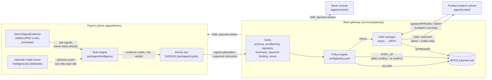

# VIRAAM

**A coercion-aware circuit breaker for UPI payments.** Hackathon Round 1 prototype.

*Viraam* (विराम) means "pause". When someone is being coerced into paying, for example kept on a 47-minute
"digital arrest" call while a scammer controls their screen, the payment rail sees nothing unusual: a valid
user, a valid PIN, a valid payee. VIRAAM adds the one thing the bank is missing, **situational context**,
without handing over the user's private data.

At payment time, the phone looks at its *own situation*, not at whether the payee is risky. It asks: is a long
call active, is something controlling the screen, is this payee new, is this hour unusual? It reduces those
signals to **evidence codes** and emits a **signed attestation**: a verdict, a 0–100 risk score and the codes,
with **no raw personal data**. The bank verifies the signature and applies its own declarative policy:

| Outcome | What happens |
|---|---|
| **ALLOW** | Payment goes to the rail. |
| **STEP_UP** | Cooling-off period, then the payer must re-confirm with a *fresh* attestation. |
| **HOLD** | Payment frozen. The payer's **trusted contact** is asked on *their own* device to approve or deny. No answer before expiry means **DENY**. |

> Everything here is offline and synthetic. There is no bank, NPCI or UPI integration; the payment rail is an
> in-memory mock. Every name, VPA (`@mockupi`), device id and key is invented for the demo.

---

## Run it

Requires **Node 20+** and **pnpm 9** (`corepack enable`, or `npm i -g pnpm@9`).

```bash
pnpm install
pnpm dev
```

`pnpm dev` starts all four processes:

| URL | What |
|---|---|
| http://localhost:5173 | **Payer's phone**: scenario picker, phone, "stayed on phone" vs "sent to bank" panels |
| http://localhost:5174 | **Trusted contact's phone** (Ravi) |
| http://localhost:5175 | **Bank console**: live decision stream |
| http://localhost:4000 | **Gateway**: attestation verify, policy, mock rail, SSE |

No network access is needed at runtime: no CDNs, web fonts or external APIs.

Other commands:

```bash
pnpm verify      # end-to-end verifier: all scenarios + attack cases against the real gateway (52 checks)
pnpm typecheck   # tsc across all 7 workspace packages
pnpm build       # production build of the three React apps
```

---

## Architecture



### Monorepo

```
viraam/
  apps/device             React: simulated phone, payment screen + VIRAAM overlay
  apps/trusted            React: trusted contact's approval screen
  apps/console            React: bank operations console, live decision stream
  services/gateway        Node + Express: attestation verify, policy, mock rail, SSE
    config/policy.yaml      the bank's rules, as data
    config/registry.json    enrolled public keys + trusted-contact enrolment
    scripts/e2e.ts          `pnpm verify`
  packages/schema         Zod schemas, shared types, evidence codes, DeviceSignalCollector, demo scenarios
  packages/crypto         Ed25519 keygen/sign/verify (@noble/curves), canonical JSON, envelopes
  packages/intelligence   Rule engine (default) + copy generator; ./ai = optional model pieces
```

Packages are consumed as TypeScript source. There is no build step between them.

---

## The attestation

What actually crosses the wire for the "digital arrest" scenario:

```json
{
  "alg": "Ed25519",
  "keyId": "key_dev_asha_demo_01",
  "payload": {
    "version": 1,
    "deviceId": "dev_7f3a9c2e1b5d",
    "issuedAt": 1761552840000,
    "nonce": "9b1e4c7a2f6d3e8b0a5c1d7e4f2a9b6c",
    "sessionRisk": 100,
    "verdict": "HOLD",
    "evidence": ["CALL_ACTIVE_GT_30M", "REMOTE_ACCESS_SERVICE_ACTIVE", "PAYEE_FIRST_SEEN", "AMOUNT_GT_P99", "OFF_PATTERN_HOUR"],
    "payeeNovelty": "FIRST_SEEN",
    "amountBand": "1L_TO_5L",
    "paymentBinding": "7b9afee625c1f918f4020550790d75a273599f8363487d5b786507f6116084ec",
    "scorer": "rules-v1"
  },
  "signature": "a6af7a8d…2944c00"
}
```

| Field | Meaning |
|---|---|
| `deviceId` | Pseudonymous per-install id. Not an IMEI, phone number or account id. |
| `issuedAt`, `nonce` | Freshness and replay protection. |
| `sessionRisk`, `verdict` | The device's own assessment: advisory input to bank policy. |
| `evidence` | Boolean situational facts (see below). |
| `payeeNovelty`, `amountBand` | Coarse buckets, never exact history or amounts. |
| `paymentBinding` | `sha256(canonical{paymentId, payeeVpa, amountPaise})`, so the attestation is valid for exactly one payment. |
| `scorer` | Provenance: `rules-v1`, or `rules-v1+model-lr-v0` when the optional model is on. |

The signature covers `"VIRAAM-ATTESTATION-v1\n" + canonicalJSON(payload)` (sorted keys). The domain prefix
stops a signature for one message type from being replayed as another. The schema is `.strict()`: an
attestation carrying **any** extra field is rejected as `MALFORMED`, so raw data can't be smuggled in.

### Evidence codes

| Code | Asserts |
|---|---|
| `CALL_ACTIVE_GT_30M` | A voice call has been active for over 30 minutes |
| `REMOTE_ACCESS_SERVICE_ACTIVE` | A service that can read/drive the screen is running |
| `SCREEN_SHARE_ACTIVE` | The screen is being captured or mirrored |
| `SIDELOADED_APP_RECENT` | An app from an unknown source was installed in the last 72 h |
| `PAYEE_FIRST_SEEN` | This device has never paid this payee |
| `AMOUNT_GT_P99` | Amount exceeds the user's own 99th-percentile payment |
| `OFF_PATTERN_HOUR` | Outside the user's usual transacting hours |
| `RAPID_APP_SWITCHING` | Unusually frequent app switching (a coaching signal) |

### Deliberately excluded, and why

| Never transmitted | Why it's excluded | What's sent instead |
|---|---|---|
| Caller's number, contact name | Identifies a third party who never consented; would turn the bank into a call-log collector | `CALL_ACTIVE_GT_30M` |
| Call audio or transcript | Content surveillance; also unnecessary, since *duration while paying* is the signal | nothing |
| Exact call duration | Precision adds no decision value over the threshold and fingerprints behaviour | the code alone |
| App names / package names | Reveal health, religion, dating, finance apps; also brittle (scammers rename tools) | `REMOTE_ACCESS_SERVICE_ACTIVE`, `SIDELOADED_APP_RECENT` |
| Screen contents / screenshots | The most sensitive data on the device, and may include OTPs | `SCREEN_SHARE_ACTIVE` |
| Contact list, payee history | Social graph. The bank only needs "new or not" | `payeeNovelty` |
| Transaction history, percentile value | Spending profile | `AMOUNT_GT_P99`, `amountBand` |
| Location, usual hours, activity timeline | Movement and routine are highly identifying | `OFF_PATTERN_HOUR` |
| Hardware ids (IMEI, Android ID, MAC) | Cross-context tracking | pseudonymous `deviceId` bound to an enrolled key |

Data minimisation also applies downstream: the **trusted contact** sees an amount *band* and the evidence
in plain language. They do **not** see the payee's name or VPA or the exact amount (`pnpm verify` asserts this).
Raw signals exist only in device memory long enough for the rule engine to evaluate them. The device app
displays them in a demo panel labelled *"Stayed on this phone"* so the audience can see the contrast.

---

## Bank-side policy

Pipeline in `services/gateway/src/verify.ts`. The first failure rejects the payment and shows as `REJECTED`
in the console:

1. **Schema**: strict Zod parse → `MALFORMED`
2. **Enrolled key**: `keyId` must be in `config/registry.json`, role `device`, bound to the payload's `deviceId` → `UNKNOWN_KEY`
3. **Signature**: Ed25519 over domain + canonical payload → `BAD_SIGNATURE`
4. **Freshness**: no older than `maxAgeSeconds`, no further ahead than `maxFutureSkewSeconds` → `STALE` / `FROM_FUTURE`
5. **Payment binding**: hash and amount band must match *this* payment → `BINDING_MISMATCH`
6. **Nonce**: unseen within TTL (consumed only once 1–5 pass) → `REPLAYED_NONCE`

Then **`config/policy.yaml`** is evaluated top to bottom. The first rule whose conditions all match decides.
Rules are data, not code:

```yaml
- id: coercion-signature
  description: Long call while someone can see or control the screen, paying a first-seen payee.
  when:
    evidenceAll: [CALL_ACTIVE_GT_30M, PAYEE_FIRST_SEEN]
    evidenceAny: [REMOTE_ACCESS_SERVICE_ACTIVE, SCREEN_SHARE_ACTIVE]
  outcome: HOLD
```

Available conditions: `evidenceAll`, `evidenceAny`, `sessionRiskAtLeast`, `deviceVerdictIn`,
`amountBandIn`, `payeeNoveltyIn`. The file is schema-validated at startup; a typo fails loudly.

- **STEP_UP**: `stepUp.coolingSeconds` (15 s for the demo). Re-confirming early returns `425`. Re-confirming after the cooling period needs a **fresh** attestation (new nonce); if the situation got worse meanwhile, it escalates to HOLD.
- **HOLD**: the trusted contact's reply is itself an Ed25519-signed envelope (`VIRAAM-HOLD-RESOLUTION-v1`) verified against *their* enrolled key. The payer's key can't approve their own hold. After `hold.expirySeconds` with no answer, the payment is **DENIED**: silence never releases money.
- **Unattested payments** (no VIRAAM on the phone): `unattested.outcome: ALLOW` mirrors today's rail. A bank enforcing VIRAAM would set `REJECT`.

---

## AI supports the system; it is not the system

The default decision path is fully deterministic:

```
raw signals ──deriveEvidence()──▶ evidence codes ──RuleBasedRiskScorer──▶ risk ──decideVerdict()──▶ verdict
                (thresholds in one const)          (weights in one const)        (hard rules + thresholds)
```

and the bank re-decides from the evidence with `policy.yaml`. **No model is involved anywhere by default.**

Model-based pieces sit behind two interfaces in `packages/intelligence/src/types.ts`:

| Interface | Default (rules) | Optional (`packages/intelligence/src/ai/`) |
|---|---|---|
| `RiskScorer` | `RuleBasedRiskScorer` (`rules-v1`): fixed weights + combination bonus | `LogisticRiskScorer` (`model-lr-v0`): a small logistic model over evidence codes. Its coefficients are **hand-set placeholders**, not trained on anything; there is no real data in this repo. |
| `InterventionCopyGenerator` | `TemplateCopyGenerator`: deterministic templates | `SalienceCopyGenerator`: same templates ordered by model weight. This is the slot for an on-device small language model. |

Guard rails, enforced **outside** the `ai/` folder in `assess.ts`:

- A model sees **evidence codes only**, never raw signals.
- Its score can **raise** risk above the rule score, never lower it (`max(rule, model)`).
- It can't override the hard rule (`call + screen control + new payee ⇒ HOLD`) or bank policy.

**It's removable, and that has been tested.** Delete `packages/intelligence/src/ai/` and then:

- `pnpm typecheck` passes. Nothing imports `ai/` statically: the device app discovers it with `import.meta.glob`, and the verifier with a non-literal dynamic import.
- The device app builds and runs. The "Optional model scorer" toggle disappears.
- `pnpm verify` passes all rule-path checks and reports the model-assisted run as skipped.
- All four demo scenarios behave the same in the browser.

(If you delete or restore the folder while `pnpm dev` is running, restart it. Vite caches the glob result.)

---

## REAL vs SIMULATED

| Component | Status | Notes |
|---|---|---|
| Device sensor layer (call state, remote access, screen share, sideload, app switching) | **SIMULATED** | `SimulatedDeviceSignalCollector` replays seeded scenarios. **No phone sensors are read.** See the interface below. |
| Payee history, user's p99 amount, usual hours | **SIMULATED** | Seeded per scenario; a real app computes these from its local transaction store. |
| Evidence derivation, risk scoring, device verdict | **REAL** | Deterministic rule engine, runs in the browser exactly as it would on device. |
| Ed25519 signing and verification | **REAL** | `@noble/curves`. Domain-separated, canonical JSON. |
| Device and trusted-contact keys | **SIMULATED** | Derived from public seed labels (`deriveDemoKeyPair`) so the demo is reproducible. Anyone can recompute them. Production: generated in Android Keystore / StrongBox, enrolment backed by Key Attestation. |
| Key enrolment / registry | **SIMULATED** | Static `config/registry.json`. Production: registered during bank-app onboarding. |
| Gateway verification (schema, key, signature, freshness, binding, replay) | **REAL** | Exercised by `pnpm verify`, including forged, stale, replayed, tampered and mis-bound attestations. |
| Policy engine (`policy.yaml`) | **REAL** | Declarative, validated, first-match. |
| Hold workflow, trusted-contact signed approval, expiry → DENY | **REAL** (logic) | Notification over local SSE stands in for push notifications. |
| Payment rail | **MOCK** | In-memory ledger issuing fake `MOCKRRN…` references. No bank, NPCI or UPI integration. |
| Identities, VPAs, amounts | **SYNTHETIC** | `@mockupi` handles; "Asha" and "Ravi" are fictional. |
| Optional model scorer | **PLACEHOLDER** | Hand-set coefficients; see above. |
| State persistence | **IN-MEMORY** | Restarting the gateway clears payments, holds and nonces. |

### `DeviceSignalCollector`: the seam for a native collector

Exported from `packages/schema` (`src/signals.ts`):

```ts
export interface DeviceSignalCollector {
  /** Where the signals come from. Shown in the UI so a simulated source is never mistaken for a real one. */
  readonly source: 'simulated' | 'android-native' | 'ios-native';
  collect(context: PaymentContext): Promise<DeviceSignals>;
}

export interface PaymentContext { payeeVpa: string; amountPaise: number }
```

`DeviceSignals` is a strict Zod schema (also exported) with `capturedAt`, `localTime`, `call {active,
durationSeconds}`, `remoteAccessServiceActive`, `screenShareActive`, `sideloadedAppInstalledHoursAgo`,
`appSwitchesLast60s`, `payeeHistory`, `amountStats`, `usualActiveHours`. Even the *local* snapshot contains no
numbers, names, app identifiers or content.

How a native Android collector would fill it (indicative):

| Field | Android source |
|---|---|
| `call.active`, `durationSeconds` | `TelephonyManager` + `TelephonyCallback.CallStateListener` (`READ_PHONE_STATE`), local timer |
| `remoteAccessServiceActive` | `AccessibilityManager.getEnabledAccessibilityServiceList()` filtered to services that can retrieve window content or perform gestures |
| `screenShareActive` | `WindowManager.addScreenRecordingCallback` (API 35+); virtual displays via `DisplayManager` on older versions |
| `sideloadedAppInstalledHoursAgo` | `PackageManager.getInstallSourceInfo()` + `PackageInfo.firstInstallTime` |
| `appSwitchesLast60s` | `UsageStatsManager.queryEvents()` (`ACTIVITY_RESUMED`), with explicit usage-access consent |
| `payeeHistory`, `amountStats`, `usualActiveHours` | The payment app's own local store |

Contract: return only these fields; never persist or transmit the snapshot; when a signal is unavailable
(permission denied, older OS), report the benign value. **VIRAAM must degrade to "less evidence", never to
"block".**

---

## Demo scenarios

Seeded and deterministic. Pick them from the left panel of the device app.

| # | Scenario | Inputs | Expected |
|---|---|---|---|
| 1 | Normal payment | ₹340 to a store paid 42 times, 11:05 AM, no call | **ALLOW**, no evidence |
| 2 | Digital arrest | 47-min call, remote-access service on, first-seen payee, 2:14 AM, ₹2,00,000 | **HOLD** (`coercion-signature`) → Ravi denies → **DECLINED** |
| 3 | False positive guard | 52-min family call, sister paid 18 times, ₹1,450, 7:40 PM | **ALLOW**. The long call *is* detected (`CALL_ACTIVE_GT_30M`, risk 20) but alone it isn't coercion. |
| 4 | VIRAAM disabled | Same inputs as #2, layer off | **Settles**. Console shows **UNPROTECTED**: the bank had no context. |
| 5 | Cooling-off (bonus) | ₹48,000 to a new landlord, 11:30 PM, no call | **STEP_UP**: 15 s pause, then re-confirm |

`pnpm verify` runs all five through the real gateway twice (rule engine only, then rules + optional model), plus
the attack cases and hold expiry.

---

## 90-second demo script

**Setup (before recording).** Run `pnpm dev`. Open three browser windows side by side: **device**
`localhost:5173` (wide, centre), **trusted** `localhost:5174` (right), **console** `localhost:5175` (bottom
or a second screen). On the console, click **Clear**. Check that the device panel says *Gateway connected*
and the console says *LIVE*.

| Time | Click | Point at / say |
|---|---|---|
| 0:00 | Device: **4 · VIRAAM disabled** | "Asha has been on a call for 47 minutes. A fake officer had them install a remote-access app. It's 2:14 AM." Point at the green **On call** and amber **Screen control** pills. |
| 0:08 | Device: **Pay ₹2,00,000** | Phone shows **₹2,00,000 sent**. Console: red **UNPROTECTED** card: *"The bank had no situational context."* "This is today." |
| 0:18 | Device: **2 · Digital arrest** | The VIRAAM toggle switches **on**. Same call, same app, same payee, same amount. |
| 0:22 | Device: **Pay ₹2,00,000** | Phone shows the calm VIRAAM overlay: *"Let's pause this payment."* with reasons. Right panel **Sent to the bank**: only evidence codes. "No phone number, no app name, no screen contents." |
| 0:32 | (look at console) | **HOLD** card: rule `coercion-signature`, evidence chips, six green verification checks. |
| 0:38 | (look at trusted phone) | Ravi's phone: *"Asha's payment is paused"*. Ravi sees a band (₹1 lakh – ₹5 lakh), not the payee. |
| 0:45 | Trusted: **Stop this payment** | Device: *"Ravi stopped this payment. ₹2,00,000 is still in your account."* Console card flips to **DECLINED**. "Ravi's reply was signed on Ravi's phone." |
| 0:55 | Device: **3 · False positive guard** → **Pay ₹1,450** | Sent. Console: **ALLOW** with `CALL_ACTIVE_GT_30M` shown. "We saw the hour-long call. It's a family call to a known payee, so we don't block it." |
| 1:05 | Device: **1 · Normal payment** → **Pay ₹340** | **ALLOW**, *No evidence codes*. "Normal payments don't notice VIRAAM." |
| 1:12 | Device: expand **Signed envelope (Ed25519)** | "Signed on device, verified by the bank, bound to this one payment, single-use nonce." |
| 1:20 | Point at **Optional model scorer** toggle | "The rule engine decides. The model is optional: delete its folder and everything still runs." |
| 1:30 | End | |

If you have more time, add **5 · Cooling-off**: Pay, wait out the 15 s ring, then **Yes, pay ₹48,000**. It
settles as **STEP UP → SETTLED** on the console.

---

## Known limits (prototype honesty)

- No sensors are read; the collector is simulated. A real collector also needs anti-tamper protection: on a
  rooted or compromised device, the signals and the key are only as trustworthy as the OS. Play Integrity /
  Key Attestation would gate enrolment.
- Demo keys are derivable from public labels. Never reuse this key scheme.
- Thresholds and weights are reasoned defaults, not calibrated on fraud data.
- State is in memory; nonces don't survive a gateway restart.
- The trusted-contact flow assumes one pre-enrolled contact; there's no enrolment UX.
